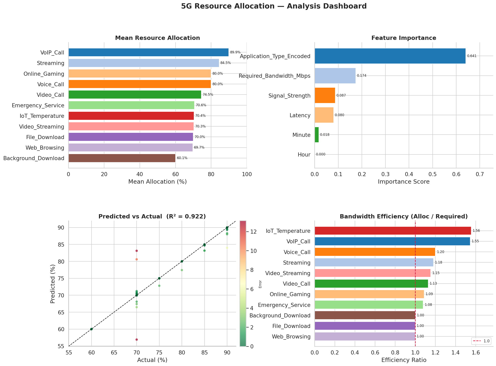

<div align="center">

# 5G Resource Allocation

Predicting how 5G networks allocate resources across apps with a random forest.

Paper *Data Science Application in ICT* · Dmitrii Savin · FEI STU Bratislava

[](LICENSE)



</div>

## Results

A `RandomForestRegressor` with 200 trees, trained on the [5G Quality of Service dataset](https://kaggle.com/datasets/omarsobhy14/5g-quality-of-service) (Sobhy, 2023), 20% held out for testing:

| R² | MAE | RMSE |
| --- | --- | --- |
| 0.922 | 0.86 % | 2.61 % |

Application type and required bandwidth matter most.

## Run

```sh
git clone https://github.com/dmitthedazed/SVOC_2025.git
cd SVOC_2025
python -m venv .venv && . .venv/bin/activate
pip install -r requirements.txt
python analysis.py
```

The figures are saved as PNGs next to the script.

Build the paper (needs TeX Live or MiKTeX):

```sh
pdflatex main.tex && pdflatex main.tex
```

<details>
<summary>How it works</summary>

1. **Cleaning.** Strip units (`dBm`, `ms`, `Mbps`, `Kbps`, `%`), parse timestamps, convert to numbers.
2. **Features.** Application type, signal strength, latency, required bandwidth, hour, minute.
3. **Model.** Random forest regressor predicting the resource allocation percentage.
4. **Evaluation.** MAE, RMSE and R² on a 20% test split.

</details>

<details>
<summary>Files</summary>

| File | |
| --- | --- |
| `main.tex` | Paper |
| `analysis.py` | Cleaning, model and figures |
| `Quality of Service 5G.csv` | Dataset |
| `fig1.png` | Predicted allocation vs signal strength by app |
| `fig2.png` | Allocation distribution by app |
| `fig3.png` | Feature importance |
| `fig4.png` | Predicted vs actual |
| `dashboard.png` | All of the above on one page |
| `signal_vs_resource.png`, `latency_vs_resource.png`, `bandwidth_efficiency.png` | Extra plots |

</details>

## Citation

```bibtex
@misc{savin2025svoc,
  author = {Savin, Dmitrii},
  title  = {Data Science Application in ICT: 5G Resource Allocation},
  year   = {2025},
  url    = {https://github.com/dmitthedazed/SVOC_2025}
}
```

## License

[MIT](LICENSE)
